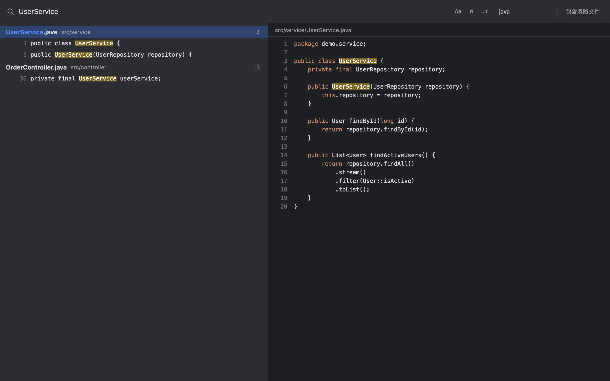
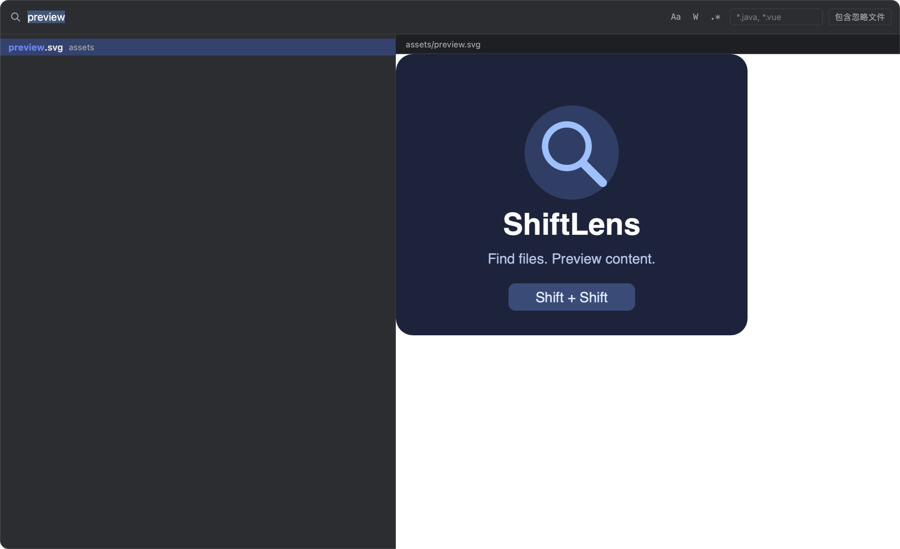

# ShiftLens · 瞬搜

**双击 Shift，搜文件、查内容、即刻预览。**

Search filenames and text across your current Orca workspace, with a native macOS floating window, syntax highlighting, and image/document previews.



## 运行环境

- macOS，支持 Apple Silicon 和 Intel Mac。
- Orca 1.4.248 或更新版本。
- Xcode Command Line Tools 或完整 Xcode。可先运行 `xcode-select -p` 检查，缺少工具时运行 `xcode-select --install` 完成系统安装。

悬浮窗随插件发布 Swift 源码，首次打开时在本机编译并进行本地签名。编译结果保存在 `~/Library/Caches/ShiftLens/native/`，按架构和源码版本复用；首次准备期间会显示通知。源码版本变化后，插件构建对应的新缓存。编译和搜索均在本机完成。

## 安装

从 Orca 的插件设置添加仓库 `2589195970/orca-shiftlens`，或执行：

```sh
orca plugin install 2589195970/orca-shiftlens --json
```

核对授权清单后，用该命令返回的指纹完成安装：

```sh
orca plugin install 2589195970/orca-shiftlens --approve <fingerprint> --json
```

插件标识为 `2589195970.shiftlens`。插件以当前用户身份运行独立 Node worker，读取当前工作区文件、调用 Orca CLI、构建和启动原生悬浮窗；声明插件自有存储与桌面通知权限。搜索数据保存在本机。

在 Orca 快捷键设置中，将 ShiftLens 的入口绑定为 `DoubleTap+Shift`，原生侧栏搜索绑定为 `Mod+Shift+F`。如果某个动作已占用双击 Shift，先在快捷键设置中调整该动作。macOS 的用户快捷键配置路径为 `~/.orca/keybindings.json`。

## 使用

| 操作 | 行为 |
| --- | --- |
| 双击 Shift | 打开悬浮窗，选中该工作区上次的搜索词 |
| ⌘⇧F | 打开 Orca 原生侧栏搜索 |
| 输入搜索词 | 实时匹配文件名；两个字符起搜索正文 |
| ↑ / ↓、PageUp / PageDown | 在文件项与命中行之间移动 |
| 单击结果 | 预览文件；代码显示语法和命中高亮，图片与文档显示原生预览 |
| Enter / 双击结果 | 在 Orca 打开文件并定位，关闭悬浮窗 |
| Esc / 窗口失焦 | 关闭悬浮窗 |
| ⌥C / ⌥W / ⌥X | 切换正文的大小写、整词、正则匹配 |

也可以从 Orca 命令面板或状态栏放大镜打开 ShiftLens。

文件名按子串和驼峰首字母匹配，忽略大小写；空格分隔的词必须全部匹配，含 `/` 的词匹配相对路径。文件名结果优先，同一文件的正文命中合并到其下。选中文件名匹配项时从文件开头预览；选中只有正文命中的文件项时定位第一处命中。

文件类型栏支持 `java`、`.vue`、`*.xml`、`!*.test.js`，用空格、逗号或分号分隔。筛选开关全局记忆，搜索词按工作区记忆，最多保存 30 个工作区。

## 文件预览

右侧支持 PNG、JPEG、GIF、WebP、SVG、HEIC 等图片，以及 PDF、办公文档、音视频等 macOS Quick Look 可识别的文件。图片按区域适配，文档使用系统预览控件；音视频由用户启动播放。具体格式取决于系统预览支持，未识别的文件显示系统文件信息。

大于 2 MiB 的文件与二进制文件交给系统预览。代码预览读取选中行前后最多各 300 行，每行最多显示约 2000 个字符，长行优先显示命中附近。切换结果、开始新查询或关闭窗口时释放当前预览。



## 搜索范围与上限

- 搜索当前本地工作区，包含前后端等子项目。远程工作区会显示提示。
- 默认遵守工作区及子目录中的 `.gitignore`，排除依赖目录、构建产物、日志、压缩包、源码映射和压缩脚本。
- 开启「包含忽略文件」后搜索这些文件；`.git` 目录始终排除。隐藏文件参与搜索，符号链接目录不递归。
- 正文针对 UTF-8 等 ripgrep 可读取的文本；办公文档、PDF、媒体、压缩包、锁文件和大于 2 MiB 的文件按文件名搜索。非 UTF-8 文本的代码预览可能出现替代字符。
- 文件名最多显示 50 项，正文最多显示 300 个文件、每个文件 30 行命中；达到正文上限时显示提示。
- 正文在输入停止 120ms 后启动，新查询会取消上一轮正文搜索。

悬浮窗围绕 Orca 前台窗口定位，适应屏幕尺寸，跟随 macOS 的明暗外观。插件停用或 Orca 退出时关闭悬浮窗及搜索进程。

## 开发与验证

```sh
npm ci
npm test
npm run typecheck
npm run check
npm run build
npm run package
```

`npm run build` 在开发目录的 `bin/` 生成本机架构的悬浮窗，便于本地调试。`npm run package` 输出独立的源码插件目录和归档，包含运行源码、界面、原生源码、许可证与发布图片。安装目录独立于源码，测试与类型生成在开发目录进行。

测试覆盖混合搜索、忽略规则、筛选、错误反馈、预览、取消查询、界面回复交错，以及原生程序的缓存、构建失败与取消。

## 许可证

[MIT](LICENSE) · Copyright © 2026 2589195970
